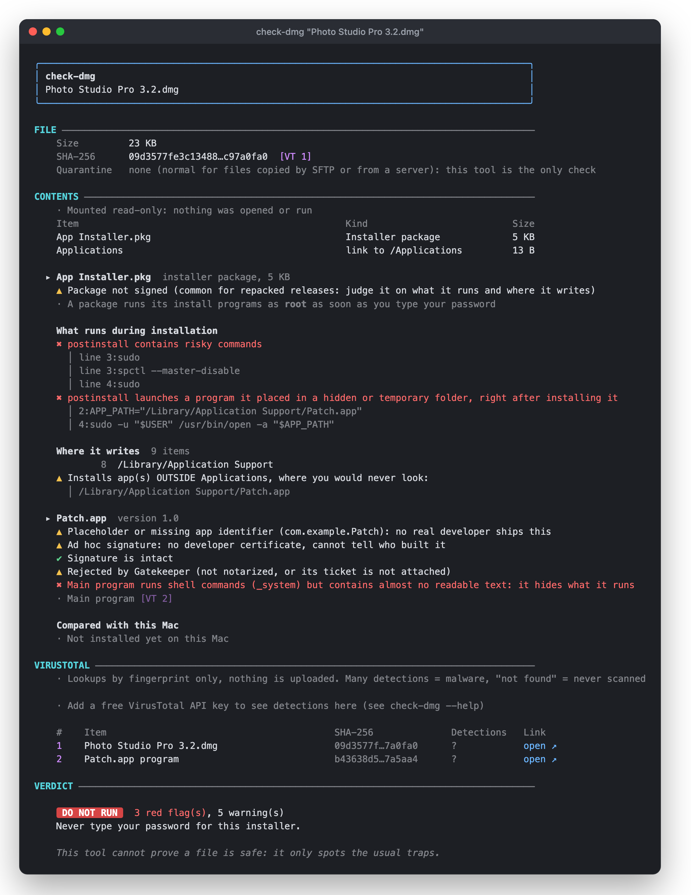
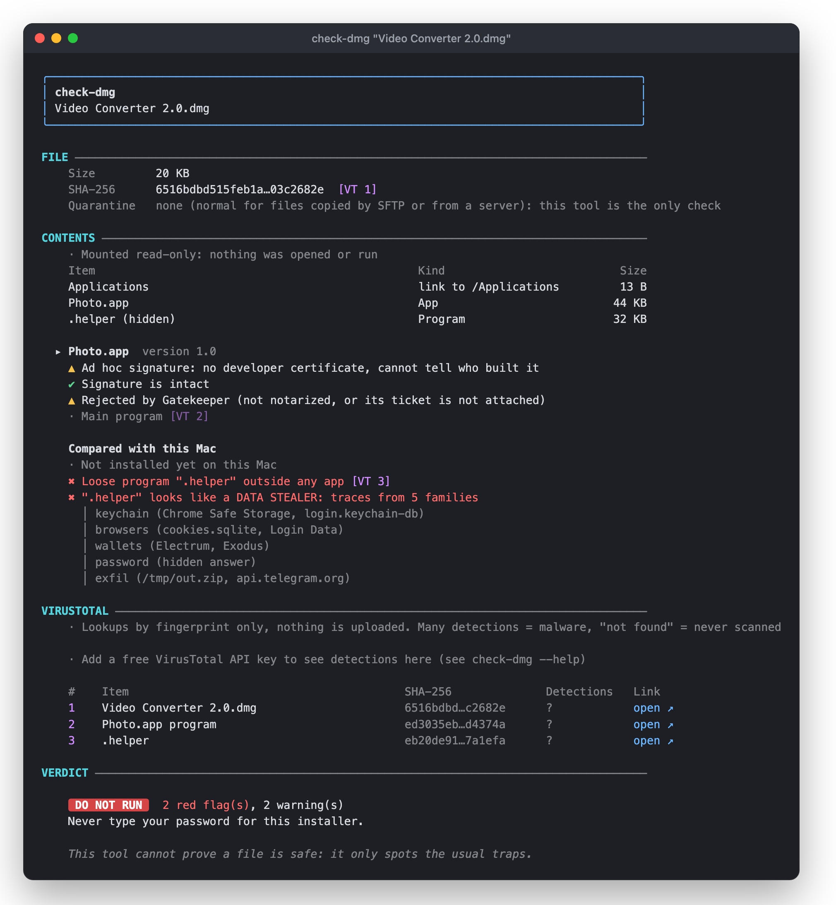
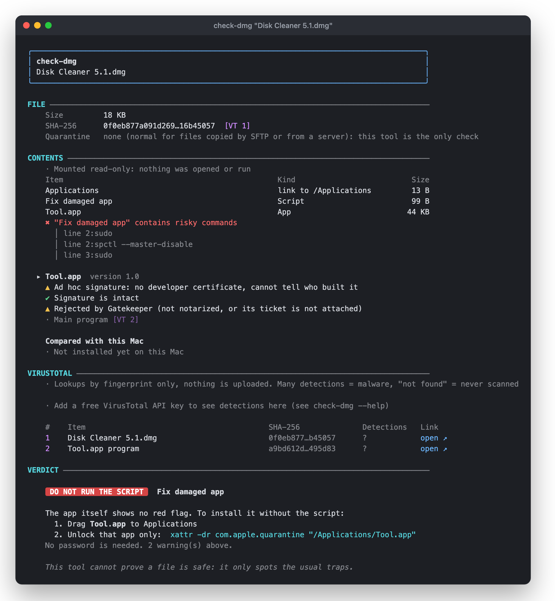

<p align="center">
  
</p>

<h1 align="center">check-dmg</h1>

<p align="center"><strong>Know what a Mac installer will do before you open it.</strong></p>

<p align="center">
  One command looks inside a downloaded <code>.dmg</code>, <code>.pkg</code>, <code>.zip</code> or app, without running anything, and tells you in plain words whether it hides a password stealer, a fake "fix" script or a program that runs as root.
</p>

<p align="center">
  <a href="#get-started"></a>
  &nbsp;
  <a href="LICENSE"></a>
  &nbsp;
  
</p>

<p align="center">
  <a href="#what-it-catches">What it catches</a> · <a href="#get-started">Get started</a> · <a href="#stay-safe-in-30-seconds">Stay safe</a> · <a href="#how-it-works">How it works</a> · <a href="#limits">Limits</a>
</p>

<p align="center">
  <a href="docs/screenshots/dropper.png"></a>
</p>

## Your password is the key

Most Macs are not infected by clever exploits. They are infected by an installer that someone opened and gave their password to.

That is exactly how the installer behind this tool worked. It looked like a well-known photo app, and it even carried the real, developer-signed installer to look legitimate. Once the password was typed, it quietly turned off Gatekeeper, hid a small app in a system folder, opened it, and that app dropped a **password stealer**. Stealers like this copy your saved passwords, your browser sessions (which open your accounts without a password or a 2FA code), your crypto wallets and your documents, in seconds.

Every sign was there, in files nobody reads. **check-dmg reads them for you.**

## What it catches

- **Password and data stealers.** Programs that reach for your keychain, browser passwords and cookies, crypto wallets or notes, or that show fake password prompts.
- **Programs that hide what they do.** A program that runs system commands but contains almost no readable text is hiding its commands. That is a dropper's signature.
- **Hidden apps.** Installers that put an app somewhere you would never look, like `/Library/Application Support`, then open it right after installation.
- **"Fix" and "patch" scripts.** Scripts that ask for your password and turn off Gatekeeper for the whole Mac, when only one app needed unlocking. You get the safe way to install instead.
- **Copy-paste traps.** Command files and Terminal files that download and run code the moment you open them, the trick behind "paste this in Terminal" pages.
- **Disguised and modified apps.** Apps that are really scripts, apps with extra code injected, unknown signers, and copies that differ from the one you already have.
- **Instructions that weaken your Mac.** Readme files that tell you to disable Gatekeeper or System Integrity Protection.

Every fingerprint is listed with a **VirusTotal** link, and with a free API key you see the number of detections right in your terminal. Your files are never uploaded.

<p align="center">
  <a href="docs/screenshots/stealer.png"></a>
  &nbsp;
  <a href="docs/screenshots/fix-script.png"></a>
</p>

## Get started

You need a Mac with macOS 13 or later. Nothing else to install: check-dmg only uses tools that ship with macOS.

```sh
mkdir -p ~/.local/bin
curl -fsSL https://raw.githubusercontent.com/arkemys-consulting/check-dmg/main/check-dmg -o ~/.local/bin/check-dmg
chmod +x ~/.local/bin/check-dmg
```

Then, before you open anything you downloaded:

```sh
check-dmg ~/Downloads/Some\ App.dmg
```

Yes, this asks you to run a downloaded script. It is a single readable file: [read it first](check-dmg). If `check-dmg` is not found, add `~/.local/bin` to your `PATH`.

### Reading the verdict

| Verdict | What to do |
|---|---|
| **DO NOT RUN** | Delete it. Never type your password for it. |
| **DO NOT RUN THE SCRIPT** | Only the script next to the app is dangerous. Drag the app to Applications and use the one-line unlock shown, no password needed. |
| **CAUTION** | Nothing alarming, but read the warnings and open the VirusTotal links. |
| **LOOKS CLEAN** | No known trap found. Still check the VirusTotal links. |

## Stay safe in 30 seconds

- **A drag-and-drop app never needs your password.** If something asks for it right after you open a new app, say no.
- **Never paste a command from a web page into Terminal**, whatever the page says it fixes.
- **Unlock one app, not your whole Mac:** `xattr -dr com.apple.quarantine "/Applications/Name.app"` instead of disabling Gatekeeper.
- **Keep a firewall and a startup watcher running**, for example [LuLu](https://objective-see.org/products/lulu.html) and [BlockBlock](https://objective-see.org/products/blockblock.html) from Objective-See. They alert you when something new connects to the Internet or tries to start with your Mac.
- **If you did give your password to something suspicious**, sign out of all sessions on your important accounts (email, password manager, banks, stores), then sign in again. That makes stolen browser cookies useless.

---

# For experts

## How it works

check-dmg is a single zsh script. It never executes anything from the file it inspects.

**Containers**
- Disk images (`.dmg`, `.iso`, `.sparseimage`) are attached read-only with `-nobrowse -noautoopen` and detached on exit. An image already mounted in the Finder is inspected in place.
- Images inside folders inside images (two levels) are opened too, a layout some release groups use.
- `.zip` files are extracted with `ditto`, Apple Archives (`.aar`, `.aea`) with `aa`, into a temporary folder that is deleted on exit.

**Apps**
- Signature from `codesign -dvv`: Developer ID or Apple, ad hoc, unknown certificate, unsigned; integrity with `codesign --verify --deep --strict`; notarization with `spctl -a -t exec`.
- Placeholder bundle identifiers (`com.example.*`, `com.yourcompany.*`, missing).
- Libraries loaded at launch that are not system libraries (`otool -L`), helpers in `Contents/Library/LaunchServices` and `LaunchDaemons` that will run as root, loose Mach-O files in `Resources`.
- Disguised apps: AppleScript applets (`main.scpt` is decompiled with `osadecompile`; run-only scripts are reported as uninspectable), Platypus wrappers, and apps whose executable is a script.
- Entitlements that accept outside code: `cs.disable-library-validation`, `cs.allow-dyld-environment-variables`, `get-task-allow`.
- Comparison with the installed copy found by bundle identifier: version, signer, and SHA-256 of the main executable and every bundled dylib. Copies slimmed by cleaner apps are compared on their `arm64` slice (`lipo -thin`). An installed copy that is developer-signed and intact is reported as the original to keep.

**Packages**
- Signature with `pkgutil --check-signature`.
- Only the `Scripts` archives are extracted (`xar` then `cpio`), never the payload, so a multi-gigabyte package is inspected in seconds. Shell scripts are scanned; Mach-O programs run by the installer are listed with their signer, the web addresses they contain and a VirusTotal fingerprint. Developer-signed programs are summarised per signer.
- Payload file list with `pkgutil --payload-files`: destination summary, items that start automatically (`LaunchDaemons`, `LaunchAgents`, `PrivilegedHelperTools`, `StartupItems`), writes to `/tmp`, `/Users`, `/usr/local/bin`, `/etc`, hidden files outside app bundles.
- Apps installed outside `/Applications` and installers inside the installer are extracted from the gzip payload by path (`cpio -id <patterns>`) and inspected recursively, two levels deep. pbzx payloads are listed but not opened.
- Install scripts that open or load something they placed in `/Library/Application Support`, `/tmp`, `/Users/Shared` or a dot-folder are flagged.

**Other files**
- Scripts and `.command` files, `.terminal` files (their `CommandString` is extracted and scanned), `.webloc` (grouped by destination), `.inetloc` and `.fileloc`, small hidden notes, hidden files and folders.
- Readmes (`.txt`, `.html`, `.rtf`, `.nfo`, `.md`): command lines are extracted (HTML is stripped of style and script blocks, RTF goes through `textutil`).

## Detection rules

| Rule | Red flag when | Warning when |
|---|---|---|
| Risky commands in a script | `curl`/`wget` piped to a shell, `base64 -d`, `osascript`, `hidden answer`, `launchctl load`, `LaunchAgents`/`LaunchDaemons`, `security find`/`dump`, `login.keychain`, `eval $(`, `sudo`, `spctl --master-disable`, `csrutil` | Only `/tmp`, `chmod +x`, `nohup`, `xattr -c`/`-d`, `display dialog`, plain `curl`; or any strong pattern in a script covered by a valid developer signature |
| Data stealer traces | Strings from 3 or more of 8 families: keychain, browser data, wallets, password prompts, exfiltration, Notes, C2, VM checks | 2 families. Developer-signed and intact programs are only noted |
| Hidden commands | Unsigned or ad hoc program importing `system`, `popen`, `exec*` or `posix_spawn*` with fewer than 25 readable strings | |
| Launch after install | Unsigned package script that opens or loads something it placed in a hidden or temporary folder | |
| VirusTotal | 5 or more engines flag the file (with an API key) | |

When every red flag comes from loose scripts next to a single app, the verdict becomes **DO NOT RUN THE SCRIPT** and shows how to install the app without it. The exit code is `1` when there is a red flag, `0` otherwise.

The stealer families and their patterns are defined near the top of the script in `STEAL_RX`. Measured against 63 installed apps on a working Mac, no legitimate app reached a red flag; two developer-signed tools (a remote desktop client and a security scanner) are only noted.

## VirusTotal

Without a key, every fingerprint is listed with a link. With a free key, detections and the suggested threat label are shown in the table.

```sh
mkdir -p ~/.config/check-dmg && (umask 077 && pbpaste > ~/.config/check-dmg/vt-api-key)
```

Or export `VT_API_KEY`. Only SHA-256 fingerprints are sent, to `https://www.virustotal.com/api/v3/files/<sha256>`. The free tier allows 4 lookups per minute: the tool waits 60 seconds between batches of four.

## Options and environment

| | |
|---|---|
| `--no-vt` | Skip VirusTotal lookups |
| `VT_API_KEY` | VirusTotal API key (otherwise `~/.config/check-dmg/vt-api-key`) |
| `NO_COLOR=1` / `FORCE_COLOR=1` | Turn colors off, or on when the output is not a terminal |
| `FORCE_LINKS=1` | Use clickable OSC 8 links even if the terminal is not detected (iTerm2, WezTerm, VS Code, Ghostty, Hyper and Tabby are) |
| `CHECK_DMG_WIDTH` | Output width in columns (60 to 100) |

## Limits

check-dmg spots the usual traps. **It cannot prove that a file is safe.**

- Packed, encrypted or obfuscated malware may expose no readable strings at all; the hidden-commands rule catches the common case, not every case.
- A program can wait before acting, or download its real payload later.
- A package that runs a compiled program as root can do more than its payload list says.
- Files copied without a quarantine flag (SFTP, some download tools) skip Gatekeeper entirely once installed.
- VirusTotal only knows files someone submitted. "Not found" means unknown, not clean.

## Tests

```sh
tests/run-tests.sh
```

The bench builds harmless fake installers and checks 18 verdicts: clean apps, fix scripts, ClickFix-style command files, hidden and embedded stealers, malicious and plain packages, a dropper package that hides and launches an app with encrypted commands, nested images, AppleScript and shell-script apps, Terminal files, instructions that ask to disable Gatekeeper, risky entitlements, and zip and Apple Archive containers. The fake stealers only contain typical strings; they do nothing. It needs the Xcode command line tools (`xcode-select --install`). Set `KEEP_FIXTURES=/some/dir` to keep the generated files.

The screenshots in this README were made from those fixtures.

## Contributing

Issues and pull requests are welcome, especially new traps seen in the wild (with a SHA-256) and false positives on legitimate software. Please add a case to the test bench with each change.

## License

MIT. See [LICENSE](LICENSE).
